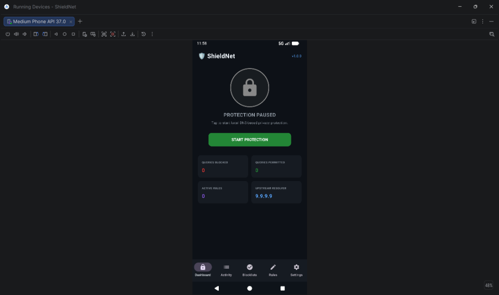
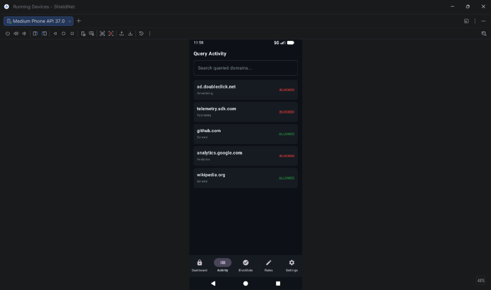
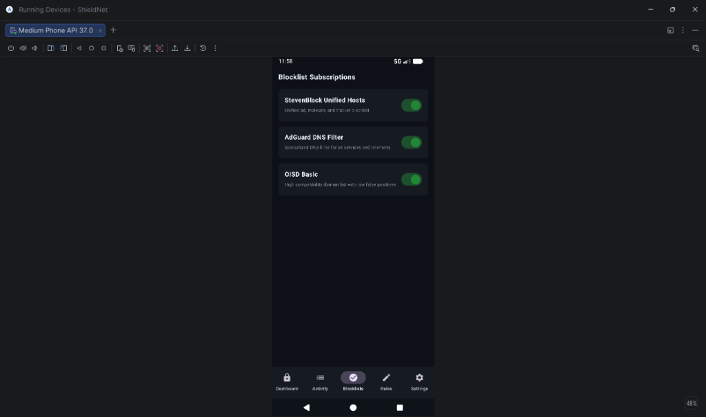
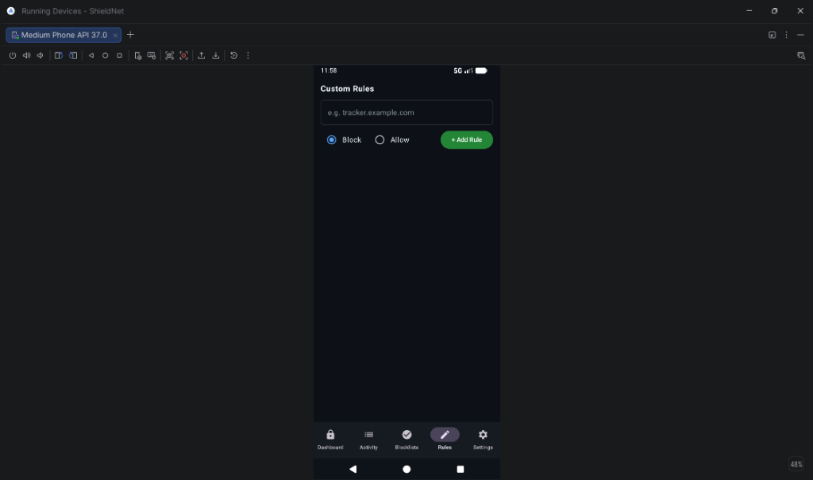
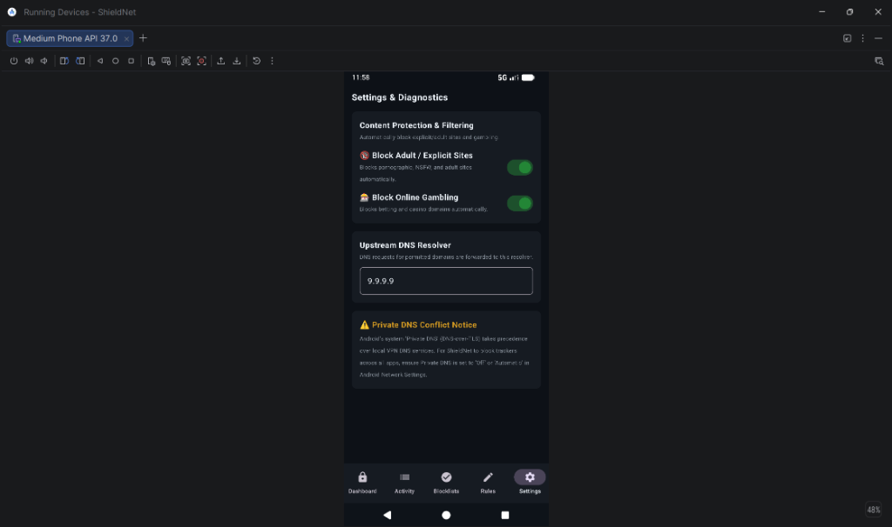

# ShieldNet — Cross-Platform Ad & Tracker Blocker

> **DNS-layer privacy protection for Windows 10/11 and Android — no HTTPS interception, no root certificates, no telemetry.**

[](https://python.org)
[](./docs/architecture.md)
[](./LICENSE)

---

## What ShieldNet Does

ShieldNet intercepts DNS resolution requests on your device and evaluates each queried domain against curated blocklists for advertising networks, tracking scripts, analytics services, and telemetry endpoints. Blocked domains receive null-routed responses (`0.0.0.0` or NXDOMAIN). Permitted domains are forwarded unmodified to your preferred upstream resolver.

### What it does NOT do
- Does not decrypt or inspect HTTPS/TLS traffic
- Does not install root certificates
- Does not operate as a web proxy or man-in-the-middle
- Does not disable Windows Defender, Firewall, or SmartScreen
- Does not transmit your browsing history or DNS queries to any server
- Does not require root on Android for basic DNS filtering

---

## 📱 Screenshots & User Interface

<div align="center">

### Android Application (Native Jetpack Compose)

| 1. Dashboard | 2. Query Activity | 3. Blocklist Sources |
|:---:|:---:|:---:|
|  |  |  |
| *One-tap protection switch & real-time metrics* | *Live log with domain search & allowlist action* | *Toggle curated ad, tracker & malware sources* |

| 4. Custom Rules | 5. Settings & Content Protection |
|:---:|:---:|
|  |  |
| *User-defined block and allow domain rules* | *Adult/Explicit & Gambling filter toggles + Upstream DNS* |

</div>

---

## Repository Structure

```
ShieldNet/
├── shared/                 # Cross-platform Python filtering engine
│   ├── filtering/          # FilterEngine (Trie) + LRU DecisionCache
│   ├── rules/              # RuleParser + BlocklistManager + DomainRule
│   ├── dns/                # DNSProxyServer (UDP + TCP, Upstream Forwarder)
│   ├── config/             # AppConfig JSON schema
│   └── tests/              # Unit + Socket Integration Tests
├── windows/
│   ├── desktop/            # PySide6/Tkinter Native Dashboard App
│   ├── service/            # Background Daemon + Windows DNS Manager
│   ├── installer/          # Inno Setup installer + service BAT scripts
│   └── tests/              # Windows-specific DNS and IPC tests
├── android/
│   ├── app/src/main/
│   │   ├── java/com/shieldnet/app/
│   │   │   ├── engine/     # Kotlin filter engine (Trie + Parser + DNS packets)
│   │   │   ├── vpn/        # ShieldNetVpnService (TUN interface + DNS routing)
│   │   │   └── ui/         # Jetpack Compose screens
│   │   ├── res/            # Android resources (colors, strings, themes)
│   │   └── AndroidManifest.xml
│   ├── build.gradle.kts
│   └── settings.gradle.kts
├── blocklists/             # Sample lists + format documentation
├── docs/
│   ├── architecture.md     # System design + sequence diagrams
│   ├── threat-model.md     # STRIDE analysis + attack mitigations
│   ├── privacy.md          # Privacy policy + limitations disclosure
│   └── troubleshooting.md  # Common issues + emergency recovery
├── scripts/
│   └── run_tests.py        # Unified test runner
├── requirements.txt        # Python dependencies
└── README.md
```

---

## Setup & Installation

### Prerequisites

**Windows:**
- Python 3.13+
- pip (bundled with Python)
- Network adapters connected (`ipconfig /all` to verify)
- Run as Administrator for DNS adapter configuration

**Android:**
- Android Studio Ladybug (2024.2.x+) with AGP 8.7+
- Kotlin 2.0+
- Android SDK API 26+ (Android 8.0+)
- A test device or emulator with Android 10+ recommended

---

### Windows: Running the Desktop Application

```powershell
# 1. Clone the repository
git clone https://github.com/yourname/shieldnet.git
cd shieldnet

# 2. Install Python dependencies (all production + test)
pip install dnspython requests

# 3. Run the native GUI Desktop Application (auto-spawns embedded daemon)
python windows/desktop/app.py
```

> **Note**: When you click "Start Protection", ShieldNet will request administrator privileges to modify adapter DNS. On standard user accounts, the DNS proxy runs locally on port 53 but adapter-level DNS redirect will not be applied automatically — you must point your adapter's DNS server to `127.0.0.1` manually.

### Windows: Service Mode (Persistent Background Daemon)

```powershell
# Launch daemon directly (non-service mode, logs to stdout)
python windows/service/daemon.py

# Install as a persistent Windows Service (requires Administrator)
.\windows\installer\service_install.bat

# Uninstall + restore DNS
.\windows\installer\service_uninstall.bat
```

---

### Android: Building the APK

**From the `android/` directory, using Android Studio:**

1. **Open Project**: Launch Android Studio → `Open` → select the `android/` folder.
2. **Sync Gradle**: Wait for Gradle sync to complete automatically.
3. **Build Debug APK**: Menu → `Build` → `Build Bundle(s) / APK(s)` → `Build APK(s)`.
4. **Output**: APK will be at `android/app/build/outputs/apk/debug/app-debug.apk`.
5. **Install**: Connect device in USB debugging mode and click `Run` (▶️), or drag the APK to an Android emulator.

**From Command Line:**
```bash
cd android
# Requires JAVA_HOME and Android SDK to be configured
./gradlew assembleDebug
adb install app/build/outputs/apk/debug/app-debug.apk
```

---

## Running All Tests

```powershell
# Run full shared + Windows test suite (Python)
python scripts/run_tests.py

# Run with pytest directly:
python -m pytest shared/tests/ windows/tests/ -v
```

**Android unit tests** (pure JVM, no device needed):
```bash
cd android
./gradlew test  # Runs DomainFilterEngineTest + DnsPacketParserTest
```

---

## Configuration

ShieldNet uses a JSON configuration file at `~/.shieldnet/config.json` (Windows) or the Android private app data directory.

```json
{
  "listen_host": "127.0.0.1",
  "listen_port": 53,
  "upstream_primary": "9.9.9.9",
  "upstream_secondary": "1.1.1.1",
  "blocking_mode": "IP",
  "block_ttl": 300,
  "auto_update_enabled": true,
  "auto_update_hours": 24,
  "enabled_blocklist_ids": ["stevenblack_hosts", "adguard_dns", "oisd_basic"],
  "enabled_categories": ["Advertising", "Tracking", "Analytics", "Telemetry", "Malware"],
  "custom_rules": []
}
```

---

## Building the Windows Installer

ShieldNet provides an [Inno Setup](https://jrsoftware.org/isinfo.php) script:

1. Download and install **Inno Setup 6**.
2. Open `windows/installer/shieldnet.iss` in the Inno Setup Compiler.
3. Click **Build → Compile**. Output installer: `windows/installer/dist/ShieldNet-Setup-v1.0.0.exe`.

> **Code Signing**: For distribution, sign the installer and `.exe` using a trusted EV or OV code signing certificate with `signtool.exe`. See Microsoft's documentation on Authenticode signing.

---

## Release Checklist

- [ ] All 21 Python tests pass (`python scripts/run_tests.py` exits with code 0)
- [ ] All Android JVM unit tests pass (`./gradlew test`)
- [ ] Blocklist download and validation tested with real URLs (integration test)
- [ ] Upstream DNS forwarding verified with Quad9 and Cloudflare (verify no loop)
- [ ] Windows service install/uninstall successfully restores adapter DNS on clean machine
- [ ] Android APK builds without warnings in release build type
- [ ] Android VPN service persists after device screen-off (battery optimization tested)
- [ ] Privacy DNS conflict notice tested on Android 9+ with DoT active
- [ ] No hardcoded credentials, API keys, or sensitive paths in codebase
- [ ] Windows Defender and SmartScreen unaffected after ShieldNet installation
- [ ] Emergency restore command verified to return internet to normal

---

## Credits & Third-Party Acknowledgments

- **[dnspython](https://www.dnspython.org/)** — DNS toolkit library. Licensed under ISC License.
- **[StevenBlack/hosts](https://github.com/StevenBlack/hosts)** — Unified Hosts file. Licensed under MIT.
- **[AdGuard Hostlists Registry](https://github.com/AdguardTeam/HostlistsRegistry)** — AdGuard DNS Filter. Licensed under GPLv3.
- **[OISD Blocklist](https://oisd.nl)** — oisd.nl domain blocklist. Licensed under CC BY 4.0.
- **[PySide6](https://doc.qt.io/qtforpython-6/)** — Qt for Python binding. Licensed under LGPL v3.
- **[Jetpack Compose](https://developer.android.com/compose)** — Android UI framework. Licensed under Apache 2.0.
