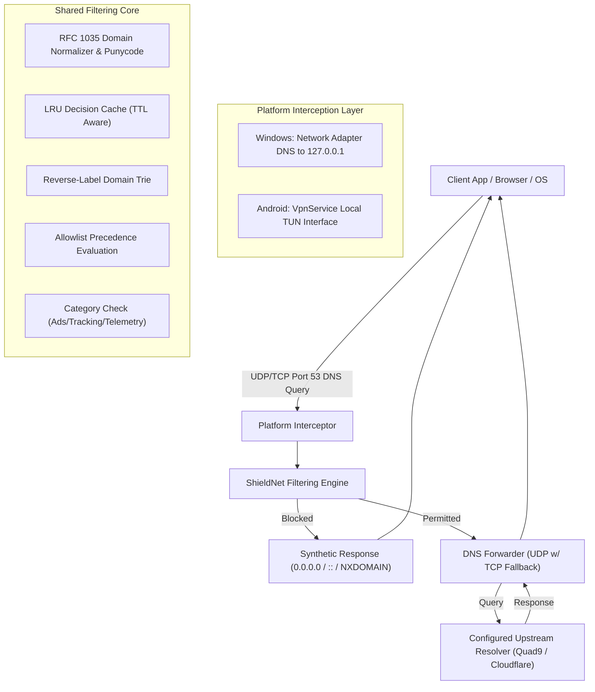
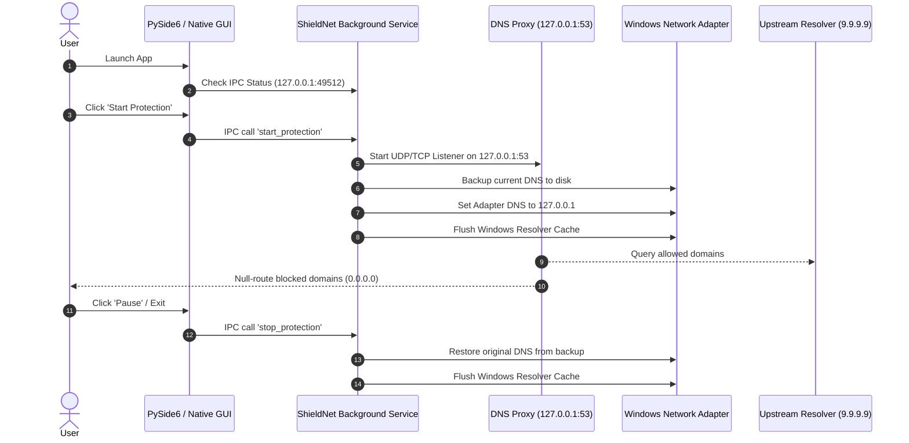

# ShieldNet System Architecture & Engineering Design

## 1. Executive Summary

**ShieldNet** is an enterprise-grade, cross-platform domain-filtering system engineered for Windows 10/11 and Android devices. It null-routes advertising, tracking, telemetry, and malware endpoints at the DNS layer without decrypting HTTPS traffic, installing unauthorized root certificates, or altering user payloads.

---

## 2. Core Filtering Engine & Domain Boundary Handling

### 2.1 Reverse-Label Trie Matching
Traditional regex or substring matching is prone to catastrophic false positives (e.g. searching for `example.com` accidentally blocking `notexample.com`). ShieldNet utilizes a **Reverse-Label Domain Trie**.

1. When a rule `||doubleclick.net^` is parsed, its labels are reversed: `["net", "doubleclick"]`.
2. When a query for `ad.sub.doubleclick.net` arrives, its labels are reversed: `["net", "doubleclick", "sub", "ad"]`.
3. Traversal begins at root:
   - Matches `"net"` -> descends.
   - Matches `"doubleclick"` -> terminal node with `is_wildcard = true`.
   - Matching terminates immediately; rule matches in $O(k)$ time where $k$ is label depth, regardless of list size.
4. When a query for `notdoubleclick.net` arrives:
   - Matches `"net"` -> looks for `"notdoubleclick"` child -> NOT FOUND -> default allow.

### 2.2 Deterministic Rule Precedence
The engine strictly executes rule evaluation in the following order:
1. **Input Normalization & RFC Validation**: Strip trailing dots, lowercase, convert IDN to ASCII Punycode, strip query strings/ports. Invalid domains are safely passed through.
2. **Allowlist Evaluation**: Checked first. If any allow rule (`@@||trusted.com^` or explicit custom allow) matches, the domain is immediately permitted.
3. **Blocklist Evaluation**: Checks block trie.
4. **Category Filter**: If a rule matches but its category (e.g., Telemetry) is toggled OFF by the user, the query is permitted.
5. **Default**: All unlisted domains are permitted.

---

## 3. Platform Architectures

### 3.1 Windows Desktop & Service Architecture

- **Persistence**: Installed as a Windows Service (`ShieldNetDNS`) via Service Control Manager (`sc.exe`).
- **Clean Fallback**: Prior to setting adapter DNS to `127.0.0.1`, a snapshot is saved to `%USERPROFILE%\.shieldnet\dns_backup.json`. Upon service shutdown or crash, original settings (DHCP or static IPs) are automatically restored.

### 3.2 Android VpnService Architecture

On Android, third-party apps cannot bind port 53 directly without root. ShieldNet uses the official Android `VpnService` API with a specialized architecture:
- **DNS-Only Routing**: `VpnService.Builder.addAddress("10.255.0.1", 32)` and `addRoute("10.255.0.1", 32)`. Only packets targeted to the virtual DNS IP enter the TUN interface.
- **Battery & Throughput Preservation**: High-bandwidth TCP/UDP app traffic (video streaming, downloads, gaming) bypasses the VPN completely and flows over the native Wi-Fi/Cellular interface.
- **Packet Loop Prevention**: Outgoing sockets to the upstream resolver call `VpnService.protect(socket)` to bypass the VPN virtual interface.
- **Private DNS Notice**: Android 9+ includes system-level "Private DNS" (DNS-over-TLS). If Private DNS is set to strict mode, Android sends DoT directly to that provider, bypassing the VPN DNS. ShieldNet detects this and guides the user.
